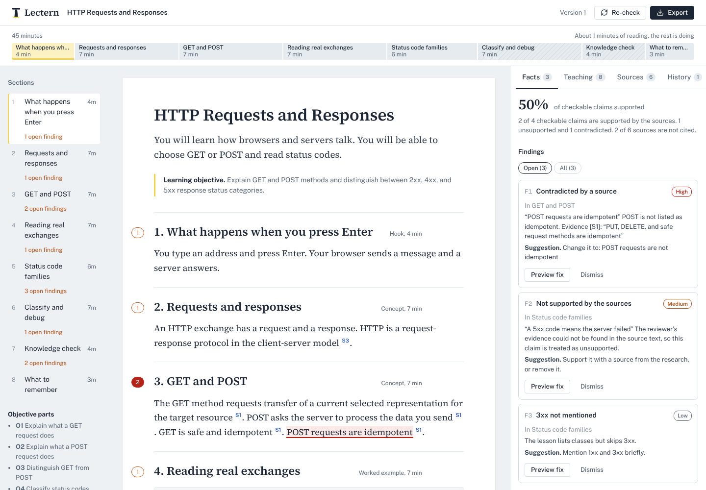

# Lectern

[](https://github.com/RaktimChandra/lectern/actions/workflows/ci.yml)

Lectern turns a lesson title and a learning objective into a 45-minute lesson in which every factual sentence cites a source that was actually read. It then reviews the lesson twice, once for factual accuracy and once for teaching quality. The instructor previews each suggested fix as a diff, applies or dismisses it, and exports the final lesson with its references and both review reports.

Built for the Kalvium Program Design task: an AI-powered lesson creation tool with two independent quality-control layers.



## How it works

1. **Break down the objective.** The objective is split into measurable parts (O1, O2, ...), each with a Bloom's level, plus prerequisites and common misconceptions.
2. **Plan the research.** Web, video and book queries, Wikipedia titles, and the authoritative domains for the topic (for HTTP: rfc-editor.org, developer.mozilla.org).
3. **Gather sources.** Web pages (Tavily or Brave, page text extracted with trafilatura), Wikipedia, YouTube (with transcripts), Google Books and Open Library, plus any URLs the instructor pastes. Sources are de-duplicated, filtered for relevance and ranked by authority. One failed lookup is a warning, not a failure.
4. **Plan 45 minutes.** Hook, concepts, worked example, activity, knowledge check and recap. The model proposes minutes; code scales them to exactly 45.
5. **Write the lesson.** Each section is written from the best-matching source passages (BM25) and cites them as `[S1]`. Citations to sources that do not exist are removed. References are generated by code from what is actually cited.
6. **Check facts (QC Layer 1).**
7. **Review teaching quality (QC Layer 2).**

Every step saves the lesson before the next one starts, so a failed step can be retried without losing anything before it.

```
Browser (React)  ──REST + Server-Sent Events──▶  FastAPI
                                                 ├─ runner: 7 steps, saved after each
                                                 ├─ research: web, wikipedia, youtube, books, reliability, BM25
                                                 ├─ llm: Anthropic / OpenAI-compatible, schema-validated replies
                                                 ├─ qc_facts, qc_instruction, fixes, exporters
                                                 └─ SQLite (one JSON document per lesson, every version kept)
```

## The two quality checks

**QC Layer 1: research and factual accuracy**

- The reviewer model lists the checkable factual claims in the lesson.
- For each claim, the five best-matching source passages are retrieved (always including the cited source's best passage).
- The reviewer judges each claim as supported, partly supported, unsupported or contradicted, and must **quote its evidence word for word**.
- **Code then checks every quote against the fetched source text.** A quote that is not in the source (exact, or a fuzzy match of 90 or more) does not count, and the verdict is lowered to unsupported. The checker cannot invent support.
- Citation integrity is checked in code: citations to sources that do not exist, factual sections without citations, claims supported only by low-reliability sources, and claims whose evidence is in a different source from the one cited.
- Every source gets a reliability tier with reasons (standards bodies and official documentation above encyclopedias, tutorials and community posts) and flags such as "not cited", "bibliographic record only" or "no transcript to check".
- A whole-lesson review looks for misleading simplifications, inconsistencies, outdated facts, omissions and examples that would not work.
- Score: share of checkable claims supported (partly supported counts half).

**QC Layer 2: instructional quality**

- Coverage map: for every objective part, which sections teach it and which questions test it. Gaps become findings, including a one-click "add a question for this part".
- Timing: reading time per section (180 words per minute plus time for code) against the minutes allotted.
- Structure: example, activity, recap and enough questions present; the activity has numbered steps and an expected result; questions have real explanations and distinct options.
- Readability (Flesch reading ease on prose only).
- A rubric review scores objective alignment, clarity, structure and flow, examples and practice, engagement, and level, each with a rationale, and lists specific issues with fixes.
- Score out of 100: 70 percent rubric, 20 percent coverage, 10 percent timing.

**Independence.** The two layers use separate prompts and inputs and never see each other's findings or the writer's reasoning. Set `QC_PROVIDER` / `QC_MODEL` to a different model from the writer to make the review independent of the author; the interface shows which model wrote and which reviewed.

## Requirements map

| Task requirement | Where it is met |
|---|---|
| Title and learning objective as inputs, with validation | New lesson form; `POST /api/lessons`; readable 422 messages |
| Research books, websites and YouTube videos | `research/providers.py`, `research/collector.py` |
| Structured lesson with explanations, examples, practical applications | Outline and draft steps; section kinds hook, concept, example, activity, check, recap |
| YouTube videos as supplementary resources | "Watch next", with the most relevant segment found from the transcript |
| Reference links at the end | Built from cited sources in `exporters.py` |
| Completed within 45 minutes | Minutes normalised to 45 in code; reading time checked per section; the lesson clock |
| QC 1: factual correctness, unsupported or misleading claims | `pipeline/qc_facts.py` |
| QC 1: reliability and relevance of sources | `research/reliability.py`, source flags |
| QC 1: gaps and inconsistencies | Whole-lesson accuracy review |
| QC 2: alignment, clarity, structure, relevance, gaps | `pipeline/qc_instruction.py` |
| Separate audit reports with issues and suggested improvements | Facts and Teaching tabs; `qc-facts-report` and `qc-teaching-report` in Markdown and JSON |
| Review, edit and save | Section editor and question editor; every save is a version |
| Review and apply QC recommendations | Preview as a word diff, edit before applying, apply, dismiss, apply all exact fixes |
| Preview | The manuscript view matches the HTML export |
| Export lesson, references and QC reports | Markdown, HTML, JSON and a ZIP bundle |
| Empty inputs, research or AI failures | Form and server validation; retries with backoff; per-step errors with readable messages |
| Preserve saved work and edits | Saved after every step; versions never overwritten; edits checked against the version they started from |
| Retry failed steps | "Retry this step" resumes from that step; interrupted runs are recovered on restart |

## Setup

Requires Python 3.11+ and Node 20+.

### Keys

| Key | For | Required |
|---|---|---|
| `ANTHROPIC_API_KEY`, `OPENAI_API_KEY`, `GEMINI_API_KEY` or `OPENROUTER_API_KEY` | Writing and reviewing | At least one (Gemini has a free tier) |
| `TAVILY_API_KEY` | Web search with page text | Strongly recommended (free tier) |
| `YOUTUBE_API_KEY` | Video search (enable "YouTube Data API v3" in Google Cloud) | Needed for video recommendations |
| `BRAVE_API_KEY`, `GOOGLE_BOOKS_API_KEY` | Fallback search, higher book quota | Optional |

Wikipedia and Open Library need no key.

Model names change often. If the configured model has been retired, Lectern lists the models your key can use, picks the closest general-purpose one and logs the switch; set `LLM_MODEL` / `QC_MODEL` to choose one yourself. For a genuinely independent review, give the reviewer a different provider, for example Gemini writes and Claude checks:

```
GEMINI_API_KEY=...
ANTHROPIC_API_KEY=...
LLM_PROVIDER=gemini
QC_PROVIDER=anthropic
```

After starting Lectern, click **Check connections** on the home page. It sends one tiny real request to every configured service and shows which ones answer, how fast, and what to fix if one does not.

### macOS and Linux

```bash
cp .env.example .env        # add your keys
make setup                  # Python venv, backend and frontend dependencies
make build                  # build the interface
make run                    # http://localhost:8000
```

For development with hot reload, run `make dev-api` and `make dev-web` in two terminals and open http://localhost:5173.

### Windows

Double-click or run from a terminal:

```bat
setup.bat      :: creates .env, the Python environment, installs everything, builds the interface
notepad .env   :: add your keys
run.bat        :: http://localhost:8000
test.bat       :: offline tests
```

### Docker

```bash
cp .env.example .env && docker compose up --build   # http://localhost:8000
```

## Using it

1. Click **Check connections** once; every required row should be green.
2. Enter a title and an objective (or click "Use the HTTP example"), choose the audience and delivery, and optionally paste trusted URLs.
3. Watch the seven steps run. If one fails, read the message and click "Retry this step".
4. Read the lesson. Hover a citation to see the verified passage behind it; click it to open the source.
5. Work through the Facts and Teaching tabs. `[` and `]` move between open findings. Preview a fix, edit it if needed, apply or dismiss it.
6. Edit any section or question directly. Changing a section's minutes rebalances the others so the lesson stays at 45.
7. After changes, click Re-check so the reports describe the current version.
8. Export the ZIP bundle.

## Sample output

`samples/` holds the exported lessons and reports for the two test lessons: *HTTP Requests and Responses* (the task's sample) and a lesson of my choice. Each folder contains `lesson.md`, `lesson.html`, `references.md`, both QC reports and `sources.json`. `docs/FACT_VERIFICATION.md` records my own check of the generated facts against primary sources.

## Tests

```bash
make test
```

The backend suite (83 tests) runs offline in about three seconds, using recorded provider responses and a scripted model. It covers time normalisation, citation parsing, quote verification, reliability tiers, provider parsers, retries (including waiting as long as a provider's `Retry-After` asks), schema repair, model discovery when a model is retired, request adaptation for newer models, the connection check, the hosting guard (passphrase, rate limits, body limit, security headers), replies shaped the way real models answer (nulls, capitalised enum values, over-long lists, sections numbered from 1), the full pipeline, verdict downgrading, failure isolation and retry, fixes and versioning, every API route, and exports including HTML escaping. The frontend has type checking and unit tests for the lesson clock and citation rendering.

GitHub Actions runs the same suites on every push (Python 3.11 to 3.13), builds the interface, builds the Docker image and smoke-tests the passphrase guard.

## Hosting

Lectern is local-first; the task does not need hosting. To share it, `docker compose up --build` or the included Render blueprint will do, and setting `ACCESS_TOKEN` locks it behind a passphrase with per-client spend limits and strict security headers. Details are in [docs/DEPLOYMENT.md](docs/DEPLOYMENT.md).

## Design decisions

The full log is in [docs/DECISIONS.md](docs/DECISIONS.md). The ones that matter most:

- **Code checks what code can check.** Minutes, citation integrity, quote existence, coverage and reading time are computed, not judged by a model.
- **Evidence must be quoted and verified.** This is the main guard against a reviewer that agrees with everything.
- **BM25 over passages, not embeddings.** Deterministic, explainable, no extra API key, and well suited to keyword-heavy technical topics. The trade-off is that paraphrased evidence can be missed; that shows up honestly as "unsupported".
- **Every reply is schema-validated.** Pydantic models double as the output schema sent to the model, with one automatic repair attempt.
- **Nothing is overwritten.** Every change is a version; edits are checked against the version they started from.

## Known limitations

- Book sources are bibliographic records (title, authors, publisher, description), not full text. They are listed as further reading and can only support what their description states.
- Transcripts are not available for every video, and YouTube sometimes blocks automated transcript access; those videos are listed without a recommended segment.
- Lexical retrieval can miss evidence that is paraphrased rather than stated.
- Quality depends on the sources the search finds; pasting a trusted URL helps.
- English only; single user; runs locally.

## What I would build next

- An API or n8n trigger so the curriculum team can run Lectern from their existing Markdown workflow.
- Batch mode for a whole module, reviewed in one queue.
- Hybrid retrieval (BM25 plus embeddings) to catch paraphrased evidence.
- A per-course style guide that the writer follows and QC 2 checks.
- Feeding student feedback (session scores and comments) back into revision suggestions.

## Acknowledgements

Libraries, APIs and data sources are listed in [docs/ACKNOWLEDGEMENTS.md](docs/ACKNOWLEDGEMENTS.md). I used AI assistants while building this project, for parts of the code and for review. I designed the workflow and the QC method, reviewed and tested the code, and verified the sample lessons against primary sources myself.

## Licence

MIT
